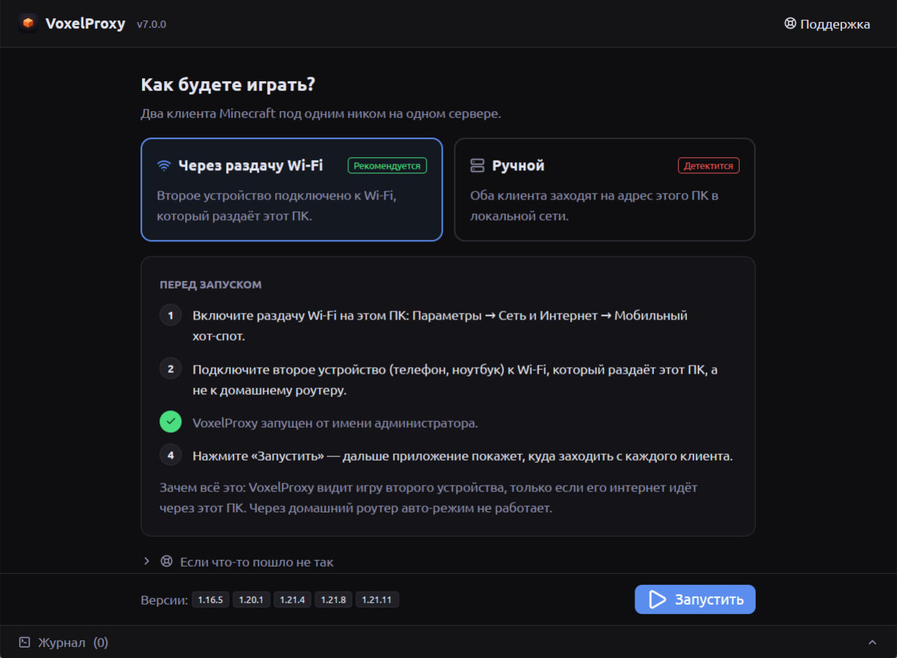

# VoxelProxy

Прокси для Minecraft: два клиента под одним ником на одном сервере.

**Поддерживаемые версии:** 1.16.5 | 1.20.1 | 1.21.4 | 1.21.8 | 1.21.11

---

## Запуск

Скачайте `voxelproxy_x.x.x_x64_ru-RU.msi` из [Releases](https://github.com/kauri-off/voxelproxy/releases/latest) и установите

### Авто (этот ПК раздаёт Wi-Fi)

Подходит, когда второе устройство выходит в интернет через Wi-Fi, который раздаёт **этот компьютер** (как точка доступа на телефоне, только тут её раздаёт ПК).

- **Запускайте от администратора** — иначе программа не сможет читать трафик.
- На компьютере должна быть включена раздача Wi-Fi (в Windows это «Мобильный хот-спот»).
- Перед запуском приложение покажет чек-лист, а после «Запустить» — по шагам, куда заходить с каждого клиента.
- Вызвали на проверку? Включите переключатель «Вызвали на проверку?» на экране сессии и выключите его после проверки.

### Ручной (Детектится)

> **Внимание:** когда модератор проверяет ПК через AnyDesk или Discord, он видит, что игра подключена к локальному адресу, а не к серверу, — за это банят. Для обычной игры используйте авто-режим.

1. Введите адрес сервера (например `mc.funtime.su`).
2. Нажмите **Запустить**.
3. Подключите оба клиента на адрес, который покажет приложение.
   Сначала основной — он станет активным, потом второй.



## Поддержка

Кнопка «Поддержка» в шапке открывает переписку с разработчиком — ответ придёт прямо в приложение.

## Сборка

```sh
cargo run                                   # запуск
cargo install cargo-packager --locked
cargo packager --release --formats wix      # MSI (Windows)
```

**Лицензия:** [GPL-3.0](LICENSE)
